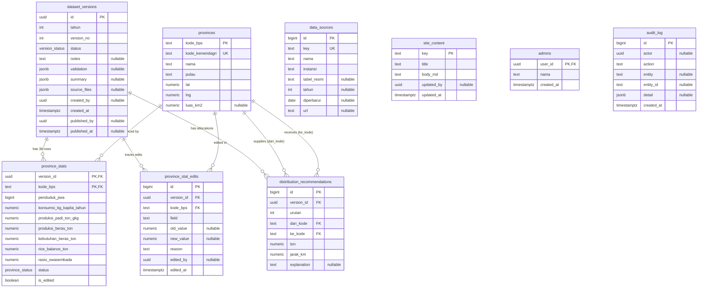

# Model Domain RiceGuard

> Berkas kanonik untuk entitas, tabel, kolom, relasi, enum, dan seed basis data. Bila kode dan berkas ini berselisih, **kode yang benar** (`supabase/migrations/0001_init.sql` dan `apps/api/app/db/models.py`) — selaraskan berkas ini pada komit yang sama.

## 1. Enum Types PostgreSQL

| Nama Enum (`0001_init.sql`) | Nilai | Dipakai pada |
|---|---|---|
| `version_status` | `draft`, `published`, `archived` | `dataset_versions.status` (default `draft`) |
| `province_status` | `surplus`, `balanced`, `defisit` | `province_stats.status` |

## 2. Tabel & Atribut

### `provinces` (Referensi Spasial 38 Provinsi)

Data master wilayah yang tidak berubah per tahun (`supabase/seed/0001_static.sql`):

- `kode_bps` `text` PK (`"11"`–`"97"`)
- `kode_kemendagri` `text` unique not null (`"11"`–`"96"` — berbeda dari `kode_bps` untuk 6 provinsi Papua)
- `nama` `text` not null
- `pulau` `text` not null (7 wilayah pulau: Sumatera, Jawa, Bali & Nusa Tenggara, Kalimantan, Sulawesi, Maluku, Papua)
- `lat` `numeric(8,4)` not null, `lng` `numeric(8,4)` not null
- `luas_km2` `numeric(12,2)` nullable (saat ini `null` hingga diisi data luas resmi)

### `dataset_versions`

Setiap set angka tahunan terikat ke satu versi. Constraint `unique (tahun, version_no)` dan partial unique index `dataset_versions_one_published` pada `(tahun) where status = 'published'` menjamin hanya **satu** versi `published` per tahun.

- `id` `uuid` PK (`gen_random_uuid()`)
- `tahun` `int` not null, `version_no` `int` not null
- `status` `version_status` not null default `'draft'`
- `notes` `text` nullable
- `validation` `jsonb` nullable — `{ "lulus": bool, "aturan": [{ "kode", "label", "status", "detail" }] }`
- `summary` `jsonb` nullable — `{ "produksi_beras_ton", "kebutuhan_beras_ton", "rice_balance_ton", "rasio_swasembada", "jumlah_status": { "surplus", "balanced", "defisit" }, "total_dialokasikan_ton", "jumlah_pasangan", "pulau_breakdown": [...] }`
- `source_files` `jsonb` nullable — peta kunci ke nama file aman, mis. `{"produksi": "...", "penduduk": "...", "konsumsi": "...", "referensi": "..."}`
- `created_by` `uuid` nullable, `created_at` `timestamptz` not null default `now()`
- `published_by` `uuid` nullable, `published_at` `timestamptz` nullable

### `province_stats`

Angka per provinsi untuk satu versi (`primary key (version_id, kode_bps)`, FK `version_id` → `dataset_versions(id) on delete cascade`, FK `kode_bps` → `provinces(kode_bps)`). Index: `province_stats_status_idx (version_id, status)`.

- Input: `penduduk_jiwa` `bigint` (`> 0`), `konsumsi_kg_kapita_tahun` `numeric(6,2)` (`> 0`), `produksi_padi_ton_gkg` `numeric(14,2)` (`>= 0`), `produksi_beras_ton` `numeric(14,2)` (`>= 0`)
- Turunan (`riceguard_calc`): `kebutuhan_beras_ton` `numeric(14,2)`, `rice_balance_ton` `numeric(14,2)`, `rasio_swasembada` `numeric(8,4)`, `status` `province_status`
- Audit ringkas baris: `is_edited` `boolean` not null default `false`

### `province_stat_edits` (Insert-Only)

Riwayat edit manual per field pada versi `draft`:

- `id` `bigint` generated always as identity PK
- `version_id` `uuid` FK `dataset_versions(id) on delete cascade`, `kode_bps` `text` FK `provinces(kode_bps)`
- `field` `text` not null, `old_value` `numeric` nullable, `new_value` `numeric` nullable
- `reason` `text` not null, `edited_by` `uuid` nullable, `edited_at` `timestamptz` not null default `now()`

### `distribution_recommendations`

Pasangan rekomendasi resmi per versi (`unique (version_id, urutan)`, index `distribution_recommendations_version_idx (version_id, urutan)`):

- `id` `bigint` generated always as identity PK
- `version_id` `uuid` FK `dataset_versions(id) on delete cascade`
- `urutan` `int` not null
- `dari_kode` `text` FK `provinces(kode_bps)`, `ke_kode` `text` FK `provinces(kode_bps)`
- `ton` `numeric(14,2)` not null (`CHECK (ton > 0)`), `jarak_km` `numeric(8,1)` not null
- `explanation` `text` nullable (kalimat deterministik dari `services/explain.py`)

### `data_sources` & `site_content`

- `data_sources`: `id` `bigint` PK, `key` `text` unique (`produksi`, `penduduk`, `konsumsi`, `referensi`), `nama` `text`, `instansi` `text`, `tabel_resmi` `text` nullable, `tahun` `int` nullable, `diperbarui` `date` nullable, `url` `text` nullable.
- `site_content`: `key` `text` PK (`hero`, `about`, `sdg2`, `how_it_works`, `limitations`, `methodology`), `title` `text`, `body_md` `text` default `''`, `updated_by` `uuid` nullable, `updated_at` `timestamptz`.

### `admins` & `audit_log`

- `admins`: `user_id` `uuid` PK FK `auth.users(id) on delete cascade`, `nama` `text` not null, `created_at` `timestamptz`.
- `audit_log` (insert-only, indeks `audit_log_created_idx (created_at desc)` & `audit_log_action_idx (action)`): `id` `bigint` PK, `actor` `uuid` nullable, `action` `text` not null, `entity` `text` nullable, `entity_id` `text` nullable, `detail` `jsonb` nullable, `created_at` `timestamptz`.

## 3. Entity Relationship Diagram

## 4. Keamanan RLS, Storage & Seed Awal

- **Row Level Security:** Loop `do $$ ... alter table public.%I enable row level security ... $$` di `0001_init.sql` mengaktifkan RLS di seluruh 9 tabel tanpa policy `anon`/`authenticated`. PostgREST publik ditolak total; hanya koneksi server FastAPI yang mengakses tabel.
- **Storage Bucket Privat:** Bucket `raw-uploads` menyimpan arsip unggahan mentah pada path `<tahun>/<version_id>/<nama_file>` (`apps/api/app/services/storage.py`) memakai `SUPABASE_SERVICE_ROLE_KEY`. Endpoint publik `/exports/raw/{nama_file}` hanya mengizinkan file milik versi `published` yang terdaftar dalam allowlist `source_files`.
- **Seed Awal:**
  - `supabase/seed/0001_static.sql`: menyemai 38 baris `provinces`, 4 baris `data_sources`, dan 6 kunci `site_content` secara idempoten (`ON CONFLICT DO NOTHING`).
  - `python -m app.seed` (`apps/api/app/services/seed.py`): membaca `dataset/raw/` → `build()` + `match()` → menyisipkan versi `2025 v1` berstatus `published`, 38 `province_stats`, dan 27 `distribution_recommendations` jika tahun `2025` belum punya versi `published`.
